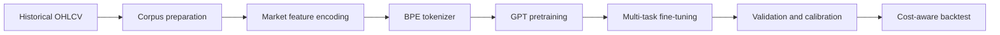

# Market Foundation Model

[](https://github.com/NodePro-gif/market-foundation-model/actions/workflows/ci.yml)
[](https://colab.research.google.com/github/NodePro-gif/market-foundation-model/blob/main/notebooks/Market_Foundation_Model_T4.ipynb)
[](https://www.python.org/)
[](https://pytorch.org/)

A research codebase for a GPT-style **market foundation model**. It converts OHLCV bars into a learned market-token sequence, pretrains a causal transformer on multi-asset data, and fine-tunes prediction heads for market direction, volatility regime, and return quantiles.

> **Research software — not financial advice.** Reported metrics are historical experiments, not guarantees of future performance. Trading costs, slippage, data quality, and out-of-sample validation materially affect results.

## Overview



| Stage | Entry point | Responsibility |
|---|---|---|
| 1. Corpus | `stage1_corpus.py`, `download_local.py` | Retrieve and verify historical multi-asset data |
| 2. Tokenizer | `stage2_tokenizer.py` | Encode market bars, train BPE merges, generate tokens and labels |
| 3. Pretraining | `stage3_pretrain.py` | Train a causal GPT-style language model |
| 4. Fine-tuning | `stage4_finetune.py` | Train direction, volatility and return-quantile heads |
| Evaluation | `validate_stage4.py`, `backtest_stage4.py` | Calibration, chronological validation and cost-aware evaluation |

### Model design

- Decoder-only transformer with 6 layers, 8 attention heads, embedding width 384 and context length 512.
- Approximately 12.44 million parameters.
- Market tokenizer: 256 base bar symbols, BPE vocabulary of 4,096 content tokens, plus context and special tokens.
- Context metadata includes asset, timeframe, market regime and session.
- Multi-task outputs: next-bar direction, volatility regime and forward-return quantiles (12, 48 and 288 bars).

## Repository layout

The existing training entry points remain at the repository root to preserve their current imports and execution commands.

```text
.
├── .github/workflows/       # Continuous integration
├── notebooks/               # Google Colab T4 training notebook
├── docs/                    # Project and reproducibility documentation
├── ckpt/                    # Pretrained checkpoint and training log
├── results/                 # Tracked experiment metrics and figures
├── stage1_corpus.py         # Stage 1: corpus download
├── stage2_tokenizer.py      # Stage 2: tokenizer and labels
├── stage3_pretrain.py       # Stage 3: GPT pretraining
├── stage4_finetune.py       # Stage 4: prediction-head fine-tuning
├── validate_stage4.py       # Calibration and validation
├── walkforward_stage4.py    # Walk-forward evaluation
├── backtest_stage4.py       # Cost-aware backtest
├── probe_transfer.py        # Cross-asset transfer experiment
├── test_tokenizer.py        # Tokenizer self-test
├── monitor.py               # Run and result monitor
├── PROGRESS.md              # Chronological experiment log
├── requirements.txt
└── pyproject.toml
```

See [Project structure](docs/PROJECT_STRUCTURE.md) for the role of supporting scripts and generated artifacts.

## Quick start

For a guided end-to-end run on a **Google Colab T4 GPU**, open [the Colab training notebook](notebooks/Market_Foundation_Model_T4.ipynb). It mounts Google Drive for persistent datasets/checkpoints, downloads the corpus, builds the tokenizer, pretrains, verifies the checkpoint, fine-tunes, calibrates and evaluates the validation-locked policy.

### 1. Environment

Python 3.10 or newer is recommended. Create an isolated environment:

```bash
python -m venv .venv
# Linux/macOS
source .venv/bin/activate
# Windows PowerShell
.venv\Scripts\Activate.ps1

python -m pip install --upgrade pip
pip install -r requirements.txt
```

For Google Colab, PyTorch is normally preinstalled. Install the remaining dependencies with:

```bash
pip install numpy pandas scikit-learn matplotlib
```

### 2. Obtain the data and prepare tokens

Raw market data and generated token arrays are intentionally excluded from Git because of their size. The downloader retrieves the available historical files; the tokenizer creates the local artifacts.

```bash
python download_local.py
python test_tokenizer.py
python stage2_tokenizer.py
```

The downloader may report unavailable source files. Review its summary and the data-provider availability before treating a corpus as complete.

### 3. Pretrain and fine-tune

The training scripts use the paths and configuration defined in their source files. On a Colab GPU runtime, prepare the token artifacts under `/content/mkt` and run:

```bash
python stage3_pretrain.py
python stage4_finetune.py
```

For the fine-tuning script, selected settings can be overridden through environment variables:

| Variable | Default | Meaning |
|---|---:|---|
| `ST4_EPOCHS` | 3 | Fine-tuning epochs |
| `ST4_BATCH` | 256 | Batch size |
| `ST4_LR` | 0.0001 | Learning rate |
| `ST4_STRIDE` | 32 | Balanced multi-asset training-window stride |
| `ST4_TEST_STRIDE` | 4 | Test-window stride |
| `ST4_HELD_STRIDE` | 8 | Held-out asset stride |

Example for a smaller CPU run (PowerShell):

```powershell
$env:ST4_EPOCHS="2"
$env:ST4_BATCH="16"
$env:ST4_STRIDE="256"
$env:ST4_TEST_STRIDE="64"
$env:ST4_HELD_STRIDE="128"
python -u stage4_finetune.py
```

**Current research protocol:** fit tokenizer statistics and BPE on non-held-out assets from 2015–2020; pretrain on 2015–2020 and select the pretraining checkpoint on 2021; fine-tune on 2015–2020 and select the supervised checkpoint on 2021; calibrate on 2022; reserve 2023 as the final test. Regenerate tokenizer and pretrained checkpoints before running this corrected pipeline; committed checkpoints and historical metrics predate the corrected protocol.

For pretraining on Colab T4, the notebook defaults to micro-batch 32 with 2 gradient-accumulation steps (effective batch 64), FP16 AMP and periodic resumable checkpoints. Fine-tuning defaults to micro-batch 64 with 4 accumulation steps (effective batch 256) and samples training windows with equal probability per non-held-out asset; checkpoint selection remains XAUUSD 2021. These are starting configurations, not guaranteed optimal settings for every runtime. Tune them only using training/validation behavior, never the final test set.

For a full reproduction, follow [Reproducibility and data protocol](docs/REPRODUCIBILITY.md) and the experiment notes in [PROGRESS.md](PROGRESS.md). Do not compare runs unless their data split, stride, seed, model checkpoint and cost assumptions match.

## Research snapshot

The committed experiment records include:

- Pretraining checkpoint: `ckpt/best.pt`.
- Pretraining validation loss recorded at step 3,000: **5.8945**.
- XAUUSD fine-tuning experiment (historical CPU run, 2 epochs): accuracy **0.5872**, AUC **0.6792**, Brier score **0.2279**. This predates the corrected checkpoint-selection split and is not a benchmark of the current code.
- Frozen-backbone transfer probe: held-out 2023 AUC of **0.7407** for NIKKEI, **0.6320** for BRENT and **0.6005** for EURGBP.

These values describe specific historical runs and configurations. They are not a single unified benchmark, and the historical fine-tuning result predates the corrected train/validation/test checkpoint-selection logic. They should not be interpreted as live-trading performance. In particular, transaction-cost assumptions and the evaluation protocol must be checked before drawing profitability conclusions. Detailed records are in `results/`, `PROGRESS.md` and the reproducibility guide.

## Quality checks

Run the lightweight checks before submitting changes:

```bash
python -m compileall -q .
python test_tokenizer.py
```

The GitHub Actions workflow runs these checks on pushes and pull requests across Python 3.10, 3.11 and 3.12.

## Documentation

- [Project structure](docs/PROJECT_STRUCTURE.md)
- [Reproducibility, data splits and evaluation](docs/REPRODUCIBILITY.md)
- [Contribution guide](CONTRIBUTING.md)
- [Experiment history](PROGRESS.md)

## Limitations

Financial time series are noisy and non-stationary. A high classification metric does not automatically imply a profitable strategy. Backtests can be affected by look-ahead bias, overlapping windows, survivorship and selection bias, spread, commissions, slippage, latency and regime changes. Validate on untouched chronological data and realistic broker costs before any real-world use.

## License

**All rights reserved.** No open-source license has been granted. Do not copy, redistribute or use this code outside the permissions granted by the repository owner.
